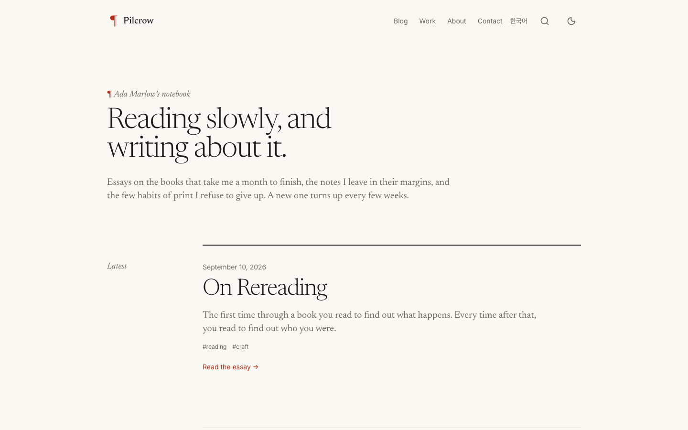

# Pilcrow

A quiet, typography-first Astro theme for writers. Good type, generous measure, nothing else in the way.

[Live demo](https://pilcrow.ondelva.com) · [Docs](https://pilcrow.ondelva.com/docs/) · [Pro version](https://pilcrow.ondelva.com)



## Features

- Astro 7 + Tailwind CSS v4, zero client-side JS by default
- Blog with tags (and a tag index), pagination, RSS, sitemap, JSON-LD
- Dark mode, responsive from 360px, Lighthouse 95+
- Type-safe content collections (MDX)
- `AGENTS.md`, Cursor rules, and Claude Code skills included

## Quick start

```sh
git clone git@github.com:ondelva/astro-theme-pilcrow-pro.git my-site
cd my-site
pnpm install
pnpm dev
```

## Configure

Edit `src/config.ts`. Everything site-specific lives there: name, URL, navigation, social links, SEO defaults.
Colors and fonts: `src/styles/global.css` (`@theme` block). See [docs/customization.md](docs/customization.md).

## Deploy

Static output. Works on Cloudflare Pages, Vercel, Netlify.
[](https://deploy.workers.cloudflare.com/?url=https://github.com/ondelva/astro-theme-pilcrow-pro)

See [docs/deploy.md](docs/deploy.md).

## Free vs Pro

|               | Free                            | Pro                                                     |
| ------------- | ------------------------------- | ------------------------------------------------------- |
| Pages         | Home, About, Blog, Contact, 404 | + Pricing, Features, Team, Changelog, Legal, Newsletter |
| Home sections | 5                               | 20+                                                     |
| Search        | –                               | Pagefind                                                |
| i18n routing  | –                               | ✓                                                       |
| Color presets | 1                               | 4                                                       |
| Support       | GitHub Issues                   | Email (im@ondelva.com), 2 business days                 |

[Get Pro →](https://pilcrow.ondelva.com)

## License

Commercial license, see [LICENSE.md](LICENSE.md).
Third-party assets: [THIRD-PARTY-NOTICES.md](THIRD-PARTY-NOTICES.md)
